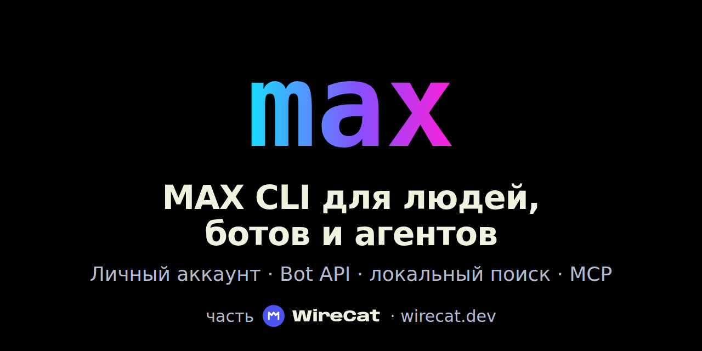

<p align="center">
  
</p>

# max: CLI для MAX и ИИ-агентов

<p align="center">
  Полный контроль над вашим MAX из терминала. Ваш аккаунт и ваши боты, все чаты и вся их история, для вас и для
  Claude Code, Codex, Cursor или любого ИИ-агента.
</p>

<p align="center">
  <a href="https://wirecat.dev/ru/docs/max">Документация</a> ·
  <a href="https://github.com/WireCatLabs/max-cli/blob/main/docs/recipes.md">Примеры</a> ·
  <a href="https://t.me/wirecatdev">Чат в Telegram</a>
</p>

<p align="center">
  <a href="https://www.npmjs.com/package/@wirecat/max-cli"></a>
  <a href="https://github.com/WireCatLabs/max-cli/actions/workflows/ci.yml"></a>
  <a href="https://www.npmjs.com/package/@wirecat/max-cli"></a>
  <a href="https://github.com/WireCatLabs/max-cli/blob/main/LICENSE"></a>
</p>

- **Полный контроль.** Подключите личный аккаунт и пишите от своего имени, или подключите бота. Чаты, группы,
  каналы, контакты, файлы и весь Bot API MAX в одном инструменте.
- **Глубокий поиск, который находит то, что пропускают другие.** Вся ваша переписка, поиск на вашем компьютере. Он
  прощает опечатки, находит синонимы и ищет по смыслу. Голосовые и файлы тоже ищутся.
- **Группы, которые ведут себя сами.** Автоответы, проверка по вашим правилам, вопросы без ответа, кто вступил и
  вышел, статистика активности.

## Что вы получаете

- **Ничего важного не пропустите.** Одна команда показывает, кто ждет вашего ответа, во всех чатах. Ничего не
  отмечается прочитанным.
- **Найдете любое сообщение за секунды.** "Когда мы договорились о встрече с Алисой?" Ответ с датой и самим
  сообщением, даже без интернета.
- **Ответите, даже когда не можете.** Автоответы по вашим правилам, тем людям, которых вы выбрали, пока вы спите или
  в дороге.
- **Порядок в группах.** Спам, флуд и чужие ссылки удаляются по вашим правилам. Вопросы без ответа, новые участники,
  итог недели.
- **Поймете любое медиа.** Голосовые становятся текстом на вашем компьютере. Текст достается из файлов и сканов. Все
  это ищется.
- **Будете знать, кто кому должен.** "Что я обещал на этой неделе и чего жду от других?" Один ответ по всем чатам.
- **Увидите всю картину.** Свяжите аккаунты человека в MAX и Telegram, добавьте WhatsApp и Google Календарь, и
  спрашивайте о человеке или проекте сразу везде.

```text
Вы:     Что я кому обещал за последние три дня?
Агент:  (вызывает max personal review 'date>3d': 12 чатов, 3 голосовых расшифровано)
        Я должен
        · Алисе Пример: прислать счет до пятницы. Личный чат, 24.09
        Жду от других
        · Борис Образцов: макет к 25.09. В группе "Дизайн" его пока нет
Вы:     Напомни Борису про макет.
Агент:  Черновик: "Борис, привет! Как там макет?" Отправить?
Вы:     Да.
```

*Люди и чаты вымышленные, вывод для примера.*

## Почему max

- **Ваши данные не покидают компьютер.** `max` общается только с MAX. Сервера WireCat нет, аккаунт у нас не нужен.
  Переписка хранится в локальной базе, которую может читать только ваш пользователь.
- **Ваш аккаунт как еще одно устройство.** `max` входит по QR-коду, как веб-версия MAX. Для личного аккаунта он
  использует неофициальный API MAX, риск описан [ниже](#личный-аккаунт). Бот работает через официальный Bot API.
- **Поиск на всю глубину.** Скачайте историю чата один раз и ищите в ней без сети. Поиск находит слово с опечаткой,
  его формы и синонимы, вопрос, который вы помните наполовину, и целые обсуждения по смыслу.
- **Можно доверить агенту.** Вы решаете, что агенту можно: только читать, писать только в чаты из списка, не больше
  стольких-то сообщений в час (по умолчанию 30). Чужой текст приходит агенту как данные, и агент не примет прочитанное
  сообщение за команду. Каждая отправка записывается в журнал.
- **Готов для любого агента.** Навык для агентов с терминалом, MCP-сервер с готовыми просьбами для Claude Desktop и
  Cursor, защищенная ссылка для ChatGPT и Claude в браузере.
- **Бесплатно и с открытым кодом.** Apache 2.0, на macOS, Linux и Windows.

Чем отличается от других инструментов для MAX: [сравнение](https://wirecat.dev/ru/docs/max/compare).

## Быстрый старт

```sh
npm install -g @wirecat/max-cli    # или: bun add -g @wirecat/max-cli
max personal setup                 # вход по QR-коду и навык для агента
max personal inbox                 # непрочитанное во всех чатах, ничего не отмечая
```

Это около пяти минут. Вы сканируете QR-код в приложении MAX, и `max` становится еще одним вашим устройством.
`personal` это имя, которое вы выбираете для аккаунта, потом можно добавить `work` или любое другое. `setup` ставит и
навык для Claude Code, Codex и Gemini CLI. Войти можно и по SMS через web.max.ru, подробности в
`max personal setup --help`.

Нужен Node.js 22.16+ или 24+, либо Bun 1.3+. Попробовать без установки: `npx @wirecat/max-cli --help`.

Подробнее: [установка](https://wirecat.dev/ru/docs/max/installation), с Windows и pnpm.

## С вашим агентом

Просите обычными словами. Агент сам выберет команды.

> *"Используй max. Что пришло с утра и кто ждет моего ответа?"*
> *"Используй max. На какие вопросы в группе Поход никто не ответил?"*
> *"Используй max. Найди PDF, который Алиса прислала про аренду."*

- **Claude Code, Codex, Gemini CLI** и другие агенты с терминалом вызывают `max` сами. `max skill install --for all`
  учит их, как.
- **Claude Desktop, Cursor** и другие MCP-приложения подключаются к `max personal mcp serve`. Готовые просьбы уже
  внутри: `/catch-up`, `/review`, `/reply`, `/find`.
- **ChatGPT или Claude в браузере** подключаются через ваш собственный туннель, после входа по одноразовому коду.

```sh
max personal mcp add claude-code --allow-writes   # или: codex
max personal mcp config                           # запись для Claude Desktop, Cursor и других
```

Подробнее: [агенты и MCP](https://wirecat.dev/ru/docs/max/mcp) · [из браузера](https://wirecat.dev/ru/docs/max/remote) ·
[рецепты](https://wirecat.dev/ru/docs/max/recipes)

## Что он умеет

### Личный аккаунт

Почти все, что умеет приложение: читать и отправлять, отвечать, пересылать, править, закреплять, реакции, опросы,
отложенные сообщения, файлы, фото, видео и голосовые, контакты, группы и каналы, другие сеансы.

```sh
max personal messages list "Алиса Пример" --limit 20
max personal messages send "Алиса Пример" "Созвонимся в 15:00?" --reply-to <id>
max personal messages send 0 "Позвонить Борису" --at-time 2h   # напоминание себе в Избранное
max personal review --new                                      # все новое с прошлого обзора
```

> ⚠️ **Для личного аккаунта max-cli использует неофициальный внутренний API MAX.** API может измениться без
> предупреждения, а использование инструмента может нарушать условия сервиса. Вы используете max-cli на свой риск.
> Авторы и контрибьюторы не несут ответственности за блокировки аккаунтов, потерю данных или другие последствия. Бот
> работает через официальный API, и к нему это не относится. Подробнее:
> [протокол неофициальный](https://wirecat.dev/ru/docs/max/security).

Подробнее: [личный аккаунт](https://wirecat.dev/ru/docs/max/usage) · [один человек](https://wirecat.dev/ru/docs/max/people)

### Поиск

```sh
max personal search all "договор аренды"                        # сообщения и заметки, лучшие сверху
max personal search messages 'from:"Алиса Пример" счет date>30d'
max personal search messages 'Во сколько выгрузка проекта Маяк?' --discover   # вопрос, который помните наполовину
max personal search conversations 'переезд за город'            # обсуждения, близкие по смыслу
max personal search messages "договор" --offline                 # не уходит с компьютера
```

Фильтры по человеку, чату, дате, файлу, ссылке и метке. Запрос можно сохранить и запускать снова. Совпадения можно
посчитать по чату, человеку или дню.

Подробнее: [поиск](https://wirecat.dev/ru/docs/max/search) · [язык запросов](https://wirecat.dev/ru/docs/max/query-language) ·
[поиск по темам](https://wirecat.dev/ru/docs/max/topic-search) · [локальная копия](https://wirecat.dev/ru/docs/max/archive)

### Группы, которые вы ведете

```sh
max personal review chat:"Поход" --unanswered          # вопросы, на которые сутки никто не ответил
max personal chats events "Поход"                      # кто вступил и вышел
max personal chats rules set "Поход" invites delete    # ваши правила: ссылки, пересылки, флуд
max personal chats moderate "Поход" --dry-run          # что нарушает правила, без действий
max personal stats chats show "Поход"                  # активность
```

По умолчанию проверка только отмечает. Для каждого действия вы решаете сами: никогда, только с флагом, с вашим
подтверждением или сразу.

Подробнее: [группы](https://wirecat.dev/ru/docs/max/groups) · [автоответы](https://wirecat.dev/ru/docs/max/replies) ·
[рейтинги](https://wirecat.dev/ru/docs/max/rankings)

### Голосовые и файлы

```sh
max personal messages transcribe "Алиса Пример" <id>   # голосовое текстом, на вашем компьютере
max personal attachments extract                       # текст из сохраненных файлов
```

Подробнее: [голосовые](https://wirecat.dev/ru/docs/max/audio-recognition) · [вложения](https://wirecat.dev/ru/docs/max/attachments)

### Бот

`max <бот> bot` работает с ботом через официальный [Bot API MAX](https://dev.max.ru/docs-api) по токену. Каждый метод
официальной схемы доступен как `max <бот> bot api <операция>`, рядом готовые команды для отправки, модерации и
событий. Бота создают на [business.max.ru](https://business.max.ru/self).

```sh
max sales bot auth set                                  # токен скрытым вводом, MAX его проверит
max sales bot recipients add "Команда продаж"           # писать только сюда
max sales bot api get-updates --limit 10                # любой метод Bot API
```

Подробнее: [бот MAX](https://wirecat.dev/ru/docs/max/bot)

### Вместе с другими источниками

`max` хранит прочитанное в той же локальной базе, что и другие инструменты WireCat, например Telegram, WhatsApp и
Google Календарь. `max personal search all` находит слово сразу в сообщениях, заметках, событиях календаря и
расшифровках встреч. У почты свой поиск в memo. `max personal contacts link` записывает, что два аккаунта это один
человек.

Подробнее: [WireCat](https://wirecat.dev/ru)

## Как это устроено

- **Еще одно устройство.** `max` подключается к MAX так же, как веб-версия. Токен входа хранится в системном
  хранилище паролей, а не в файле и не в командной строке.
- **Локальная копия.** Каждое сообщение, которое прочитал `max`, сохраняется на вашем компьютере. Историю чата можно
  скачать глубже и выгрузить в Markdown или JSONL.
- **Всегда на связи.** Фоновый `max personal serve` держит одно подключение для всех команд, а
  `max personal server install` запускает его как системную службу.
- **Вежливо с MAX.** Один темп запросов на профиль, общий для всех команд и агентов: первые 10 сразу, дальше 20 в
  минуту. Если MAX отвечает "слишком много запросов", `max` останавливается и не повторяет запрос сам.
- **Без двойной отправки.** Если связь оборвалась при отправке, `max` скажет, что исход неизвестен, и даст повтор с
  тем же `--operation-id`, который не создаст второе сообщение.
- **Для скриптов.** `--json` дает одну форму у всех команд, а у каждого вида ошибки свой код завершения.

Подробнее: [ограничения и ожидания](https://wirecat.dev/ru/docs/max/limits) · [вывод для скриптов](https://wirecat.dev/ru/docs/max/cli-contract)

## Настройки и права

У каждого аккаунта (профиля) свои настройки: что можно агенту, в какие чаты писать, сколько сообщений в час.

```sh
max personal config set permissions.messages readonly   # этот профиль не меняет сообщения
max personal config set permissions.messages.send ask   # спрашивать перед отправкой
```

Подробнее: [права](https://wirecat.dev/ru/docs/max/permissions) · [профили](https://wirecat.dev/ru/docs/max/profiles) ·
[настройки](https://wirecat.dev/ru/docs/max/configuration)

## Безопасность

Токен входа хранится в системном хранилище паролей. Локальная копия доступна только вашему пользователю. Перед каждой
отправкой, в том числе через MCP, `max` проверяет права профиля и пишет строку в журнал, без текста сообщения. Чужой
текст не управляет вашим терминалом или агентом.

Подробнее: [безопасность](https://wirecat.dev/ru/docs/max/security) · Сообщить об уязвимости:
[SECURITY.md](https://github.com/WireCatLabs/max-cli/blob/main/SECURITY.md)

## Когда что-то не так

```sh
max personal doctor            # что настроено, без подключения
max personal doctor --online   # проверить, что вход работает
```

Подробнее: [по симптому](https://wirecat.dev/ru/docs/max/troubleshooting) · [диагностика](https://wirecat.dev/ru/docs/max/diagnostics) ·
Вопросы в [чате WireCat в Telegram](https://t.me/wirecatdev). Об ошибках пишите в issues этого репозитория.

## Документация

Все на [wirecat.dev/ru/docs/max](https://wirecat.dev/ru/docs/max). Те же страницы лежат в
[docs/](https://github.com/WireCatLabs/max-cli/blob/main/docs/index.md).

## Разработка

```sh
pnpm install && pnpm test
```

Протокол MAX неофициальный и разобран обратной инженерией. Каждая операция объявлена один раз в `src/spec/`, из нее
генерируется [описание протокола](https://github.com/WireCatLabs/max-cli/blob/main/docs/dev/protocol.md).

Подробнее: [архитектура](https://github.com/WireCatLabs/max-cli/blob/main/docs/dev/ARCHITECTURE.md) ·
[проверки](https://github.com/WireCatLabs/max-cli/blob/main/docs/dev/TESTING.md)

Пулл-реквесты, сообщения об ошибках и предложения пишите в [issues](https://github.com/WireCatLabs/max-cli/issues).

## Часть WireCat

`max` один из инструментов [WireCat](https://wirecat.dev/ru): открытых локальных инструментов командной строки,
которые дают ИИ-агентам ваш контекст из мессенджеров, почты, календарей и документов. Каждый работает и сам по себе.

## Лицензия

[Apache 2.0](https://github.com/WireCatLabs/max-cli/blob/main/LICENSE)
